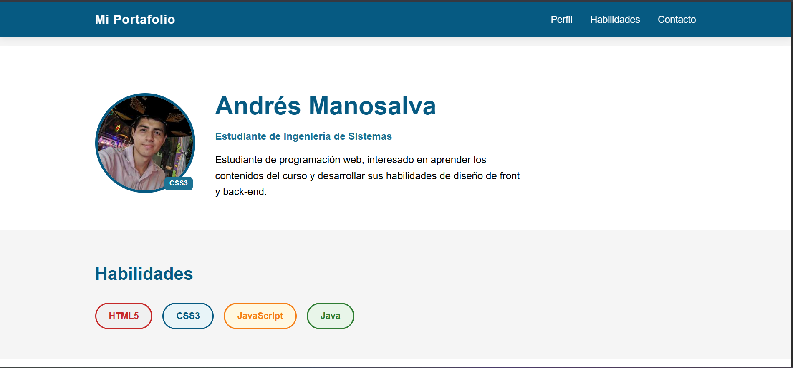
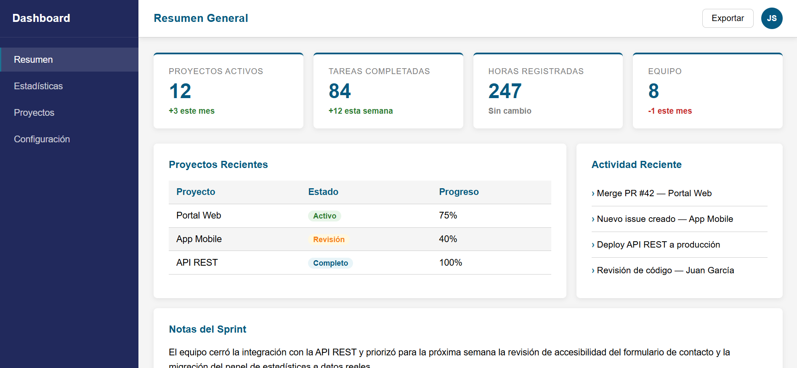
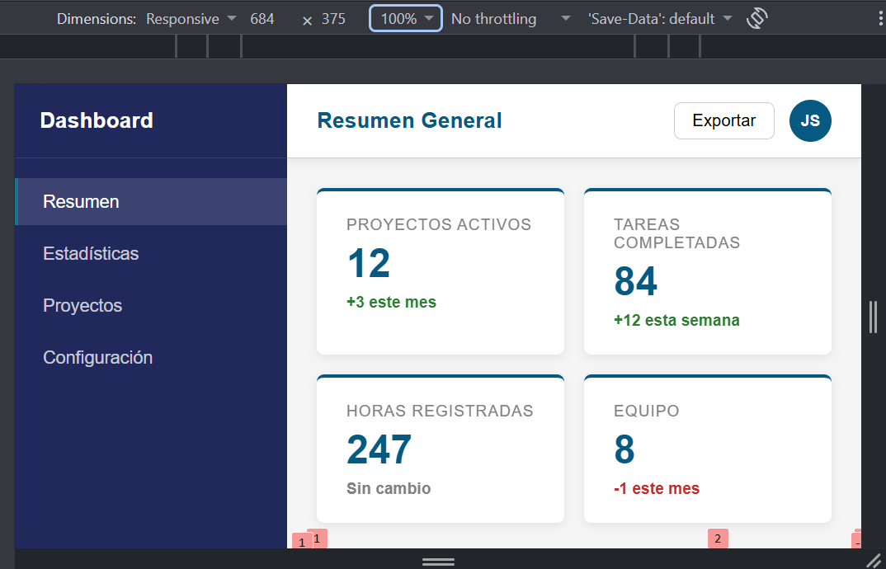

# Post-contenido — Unidad 3: CSS3 Básico

## Descripción
Repositorio del laboratorio de la Unidad 3 de Programación Web — Séptimo Semestre. Contiene dos partes: página de perfil con selectores CSS avanzados, Box Model y posicionamiento (`parte-1-perfil-css3/`) y dashboard responsivo con CSS Grid y Flexbox (`parte-2-dashboard-grid/`).

## Parte 1 — Página de perfil
Página de perfil personal que implementa selectores CSS avanzados, `box-sizing: border-box`, posicionamiento (fixed/relative/absolute), una escala de espaciado con Custom Properties (`--space-3xs` a `--space-3xl`), tipografía fluida con `clamp()` en el nombre de perfil y formulario de contacto accesible con estados `:focus`. Ver `parte-1-perfil-css3/`.

## Parte 2 — Dashboard con Grid y Flexbox
Dashboard responsivo con layout principal en CSS Grid (`grid-template-areas`), sidebar y topbar en Flexbox, stat-cards con Grid auto-fill responsivo, panel de contenido en proporción 2fr/1fr con un tercer panel ("Notas del Sprint") posicionado mediante colocación explícita de Grid (`grid-column: 1 / -1`), y tabla de proyectos con franjas zebra vía `:nth-child(even)`. Sin frameworks CSS externos. Ver `parte-2-dashboard-grid/`.

## Decisiones de diseño

### Parte 1 — Estrategia de especificidad para validación
Se eligió la Estrategia A: `:invalid:not(:placeholder-shown)`. La regla se limita a los campos de `.contact-form` e incluye tanto `input` como `textarea`. Así, los campos obligatorios vacíos no aparecen en rojo al cargar la página mientras muestran su placeholder; el borde de alerta se aplica cuando un campo deja de mostrarlo y su valor es inválido, por ejemplo, un correo con formato incorrecto.

El selector tiene mayor especificidad que `input:focus` y `textarea:focus`, por lo que el borde de error prevalece sin depender del orden de las reglas ni usar `!important`. La regla solo cambia `border-color`, así que el ring azul de foco del Paso 7 permanece visible al volver a enfocar un campo inválido. El color de alerta se define en `--color-error` para reutilizar la Custom Property, y la validación se basa en los atributos HTML `required` y `type="email"`, sin JavaScript.

### Parte 2 — Breakpoint y estrategia de layout responsivo
Se eligió una estrategia basada en Grid como estructura principal y un breakpoint de 680px para pasar a una sola columna en pantallas pequeñas.

La razón es que el ancho del sidebar fijo (220px) reduce el contenido útil del panel principal. En una pantalla de 768px, el área disponible para el dashboard es aproximadamente 548px, lo que todavía permite una composición 2fr/1fr sin comprimir demasiado la tabla y los paneles. A 680px la zona útil ya queda muy estrecha y la fila principal se vuelve incómoda, por lo que se activa el breakpoint: el layout pasa a una sola columna, el sidebar se convierte en una barra horizontal y el bloque `.content-row` se apila para mantener legibilidad.

Se mantiene Grid como eje principal porque facilita nombrar áreas, ordenar bloques y preservar la semántica visual del dashboard. Flex se conserva solo para micro-layouts internos, como navs, botones o alineación de contenido dentro de tarjetas, y no como base del esquema general.

## Cómo visualizar el proyecto
1. Clonar o descargar el repositorio en tu equipo local (`git clone [URL-del-repo]`)
2. Abre la carpeta del proyecto (`parte-1-perfil-css3`) en Visual Studio Code
3. Haz clic derecho sobre el archivo `index.html` y selecciona **Open with Live Server** (o haz clic en el botón *Go Live* en la barra inferior derecha de VS Code)
4. El proyecto se abrirá automáticamente en el navegador

## Capturas de pantalla

